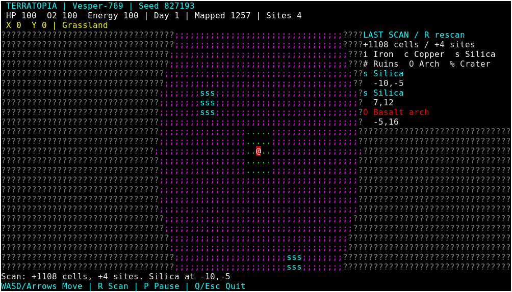

# TerraTopia

A playable, terminal-native planetary exploration prototype in Rust, powered
entirely by **Terrabox**. Explore a deterministic surface as a stranded space
explorer. Phase 1.1 adds deterministic landmarks, fog of war and a discovery scanner;
mining, crafting, creatures, spacecraft and saves are future work.

## Build and play

Install stable Rust with edition 2024 support. Keep the repositories alongside
one another:

```text
parent/
  terrabox/crates/terrabox/
  terratopia/
```

```sh
cargo build --release
cargo run --release -- --seed 827193
# Or use the binary directly:
./target/release/terratopia --seed 827193
./target/release/terratopia --help
```

The only direct dependency is `terrabox = { path = "../terrabox/crates/terrabox" }`.
No GUI, browser, async runtime or secondary terminal framework is used. The
first build downloads Terrabox's Rust dependencies. `Cargo.lock` pins resolution.
Without `--seed`, the game derives a seed from the system clock and shows it in
the interface. Seeds accept decimal integers from 0 to 18446744073709551615.
New world always restarts the selected seed; change seeds by restarting the
program with a different argument.

Run inside a real terminal, including through SSH. Linux, Windows Terminal,
macOS Terminal and Android Termux use Terrabox's native Unix/Windows paths.
On Windows run `target\release\terratopia.exe`; in Termux install Rust and build
locally with the same sibling directories. These are portability targets, not
claims of completed native testing. On Unix a controlling TTY and supported
`TERM`/terminfo entry are needed; on Windows attach stdin/stdout to a console.

## Controls

| Key | Action |
| --- | --- |
| Enter / N in main menu | Open new-world landing screen |
| Enter on landing screen | Start a fresh expedition |
| Arrows / WASD | Move one cardinal cell per key event |
| R | Scan a radius of 20 cells, report nearby sites |
| P / Space | Pause or resume |
| Enter while paused | Resume |
| M while paused / on landing screen | Main menu |
| Q / Escape / Ctrl+C / Ctrl+Q | Quit safely from any state |

Water and mountains block movement; all other terrain is walkable. There is no
held-key simulation or autonomous movement. The terminal's key repeat can still
produce repeated movement events. Returning to the menu then landing resets the
expedition, including exploration history. There are no saves.

## Interface

Actual Linux xterm capture of the running release binary (seed 827193):



After moving, the scanned terrain becomes muted remembered terrain outside local
sight. [View the exploration capture](assets/screenshots/exploration.png).
Reproduce both with `python3 scripts/capture-terminal.py` after a release build.
See [capture details](assets/screenshots/README.md) for tools and limitations.

Compact explanatory ASCII mockup (not a runtime capture):

```text
 TERRATOPIA | Vesper-769 | Seed 827193
 HP 100  O2 100  Energy 100 | Day 1 | Mapped 1257 | Sites 4
 X 0  Y 0 | Grassland
?????????????;;;;;;;;;;??????????????  LAST SCAN / R rescan
????????????;;;;;;;;;;;;????????????  +1108 cells / +4 sites
????????????;;sss;;;;;;;????????????  i Iron  c Copper  s Silica
????????????;;;;;;;;;;;;????????????  # Ruins  O Arch  % Crater
????????????;;;;..@..;;;????????????  s Silica
????????????;;;;;;;;;;;;????????????    -10,-5
Scan: +1108 cells, +4 sites. Silica at -10,-5
WASD/Arrows Move | R Scan | P Pause | Q/Esc Quit
```

The live map fills the space between three HUD rows and two status rows. The
camera follows the player near the centre; coordinates never depend on window
size. At the signed-coordinate limits the camera clamps to the world boundary.
Below 40 columns or 12 rows a clipped resize message replaces the map; game state
is retained. Narrow screens can clip long HUD lines, especially extreme
coordinates or 20-digit seeds; 80x24 or larger is recommended.

| Terrain | Glyph | Colour / background | Movement |
| --- | --- | --- | --- |
| Explorer | `@` | White / red | Player |
| Grassland | `.` | Bright green / black | Walkable |
| Forest | `T` | Green / black | Walkable |
| Desert | `:` | Yellow / brown | Walkable |
| Mountains | `^` | Grey / dark grey | Blocked |
| Water | `~` | Cyan / blue | Blocked |
| Frozen terrain | `*` | White / cyan | Walkable |
| Alien wasteland | `;` | Magenta / black | Walkable |

Landmarks overlay walkable terrain on a black background and do not change collision:

| Discovery | Glyph | Foreground |
| --- | --- | --- |
| Iron deposit | `i` | White |
| Copper deposit | `c` | Yellow |
| Silica deposit | `s` | Cyan |
| Alien ruins | `#` | Magenta |
| Basalt arch | `O` | Bright red |
| Impact crater | `%` | Yellow |

Resource names, distinct glyphs and the scanner legend identify deposits without
requiring colour perception. Stepping onto a landmark names it in the status line.

Only predictable single-cell ASCII glyphs and the standard 16-colour palette
are used. Actual colours depend on the terminal theme. Kitty graphics are not
used or required. Health, oxygen and energy currently remain at 100; the day
counter advances every 120 seconds of active simulation. Pause freezes the clock.

## World generation

The world uses signed 64-bit cell coordinates and an unsigned 64-bit seed.
Three independently salted climate fields describe elevation, temperature and
moisture. Each combines smooth fixed-point value noise at scales 128, 64 and
32 with weights 4:2:1. Stable wrapping hashes supply lattice values; interpolation
uses integer arithmetic. Division into lattice cells happens before
interpolation, preserving spatial detail at extreme coordinates.

Low elevation becomes water and high elevation mountains. Temperature and
moisture classify the remaining land into ice, desert, wasteland, forest or
grassland. A small deterministic 5x5 clearing at the origin guarantees a fallback
landing site. A bounded, deterministic ring search normally selects a site with
walkable samples eight cells away in each direction, avoiding a tiny clearing
surrounded by water. This does not guarantee every continent is reachable.

Chunks are 32x32 cells, generated lazily. Euclidean division handles negative
coordinates consistently. The game caches at most 128 chunks (131,072 tiles),
evicting the farthest chunk from the player with deterministic ties. Reading a
tile generates its chunk if absent; there is no whole-world pre-generation or
mandatory prefetch. Evicted chunks regenerate identically. Only viewport tiles
are rendered; unknown cells skip terrain lookups. Worlds have no wrapping; movement beyond `i64` bounds is rejected.
Generation does not depend on movement, terminal dimensions or loading order.
Changing the generation algorithm in future versions may change existing seeds;
no save compatibility is promised yet.

Landmark sites belong to a separate 24x24 coordinate grid. A salted hash chooses
an anchor and a ruin, deposit, arch, crater or empty region. Footprints remain
inside their owning region but can span 32x32 terrain chunks. Ruins are broken
rings, deposits are small clusters, and geological sites have arch/crater shapes.
Only walkable cells display a feature: shorelines and mountains may clip a
footprint. Placement never consumes a random sequence or examines loaded chunks.
The underlying Phase 1 biome generation is unchanged.

## Fog of war and scanning

Normal sight reveals a circular radius of 7 cells. Unknown cells render as dark
`?` glyphs; previously explored cells retain their terrain/landmark glyphs in grey
on black, while current sight uses the normal palette. The player is always `@`.
Sight is a sensor radius, not terrain-occluded line of sight.

Press **R** while playing to reveal a circular radius of 20 cells. Wide scan
visibility lasts until the next successful move; blocked movement and pause
retain it. The status line reports newly mapped cells, newly identified sites
and the nearest signal. At 80x18 or larger, a compact **LAST SCAN** panel shows
the legend and the three nearest site names and centre coordinates from that
scan. It retains the last report after movement; scan again to update it. At
smaller sizes the status line and named glyphs remain available, with clipping
on narrow screens. Scanning has no cost/cooldown or animation in this phase.

Multi-tile sites are counted once by their anchor coordinates. Repeated scans
report zero new cells/sites where nothing new is discovered. Normal sight also
records discoveries; the HUD counts all sites seen during the expedition.
Exploration uses a separate map of 1024-bit chunk masks and a site registry.
Generating or rendering terrain never marks cells explored; terrain cache
eviction does not erase discoveries. Only explored map cells request terrain
during rendering. Knowledge grows with exploration and is not evicted or saved.
A new expedition resets it. No resources can be collected or depleted yet.

## Architecture

```text
src/main.rs             CLI, terminal ownership, event waits and FrameClock
src/game.rs             State transitions and bounded fixed updates
src/input.rs            Terrabox keys -> game actions
src/renderer.rs         Terrain and screens on Terrabox Surface/Canvas
src/camera.rs           Viewport geometry and world/screen mapping
src/exploration.rs      Explored bitsets, current sight, discovery registry/reports
src/world/seed.rs       Stable hashing and planet names
src/world/noise.rs      Integer coherent noise and shared chunk lattice samples
src/world/landmark.rs   Coordinate-owned landmarks and resource identities
src/world/biome.rs      Climate classification and traversability
src/world/terrain.rs    Pure coordinate -> tile generation
src/world/chunk.rs      Chunk indexing and tile storage
src/world/mod.rs        Bounded cache and landing-site selection
src/entities/player.rs  Cardinal movement and collision
src/survival/mod.rs     Initial vitals and day counter
src/ui/mod.rs           HUD and palette
src/lib.rs              Testable game systems
tests/systems.rs        Determinism, world, movement, camera and state tests
tests/exploration.rs    Fog, scanning, landmarks, full chunk/reference equivalence
examples/benchmark.rs  Reproducible generation/cache/logical redraw workloads
scripts/smoke-terminal.py  Real-binary Unix PTY integration checks
scripts/capture-terminal.py  Actual xterm window screenshots
```

World generation, player logic and survival do not depend on terminal rendering.
The camera uses Terrabox geometry, and input/UI use its native types. These are
small modules that can evolve into a reusable TerraGame library if a second
consumer justifies it. There is no speculative ECS, persistence layer or plugin
framework.

Input actions are handled individually, simulation advances in fixed 250ms
steps, and rendering happens only when input, resize or the displayed day changes.
Terrabox `FrameClock` supplies deadlines and elapsed time. At most four simulation
steps run after a stall; excess time is discarded. While playing, the process
sleeps between four timer wakes per second. Menu and paused states have no timer
and block on input. The Surface is reused, resized only on terminal resize,
and composited through Terrabox's buffered changed-row presenter. No direct
escape output or OS input handling exists in game code. Terminal ownership is
RAII: normal exit, propagated I/O errors and panic unwinding restore modes;
forced termination/abort remain outside that guarantee.

## Validation

```sh
cargo fmt --all --check
cargo clippy --all-targets -- -D warnings
cargo test
cargo build --release
cargo run --release --example benchmark
python3 scripts/capture-terminal.py  # optional X11/xterm/ImageMagick capture tools
python3 scripts/smoke-terminal.py   # Unix, after the release build
cargo check --target x86_64-pc-windows-gnu  # optional installed Rust target
```

The PTY script follows Terrabox's documented smoke-testing approach and uses
Python's standard library. It checks menus, landing, actual WASD/arrow input,
scans and repeat-scan deduplication, fog replacement, pause, ignored paused input,
restart, small/large resize, unchanged-frame suppression,
idle CPU ticks on Linux, Q/Escape/Ctrl+C exits, cursor and alternate-screen
cleanup, and exact restoration of terminal attributes. It does not certify
physical keyboards, terminal font rendering, colour appearance or visible flicker.
See [engine inspection](docs/engine-review.md), [validation report](docs/validation.md)
and [performance measurements](docs/performance.md).

## Roadmap and current limits

Phase 1.1 includes seven biomes, collision, scrolling, menu/pause states, resize,
HUD, landmarks, three deposit types, fog and scanning. There is no mining,
inventory, environmental damage, weather, creatures, spacecraft or persistence.
Discovery memory grows with the explored area. The cache is bounded, but
exceptionally large remembered viewports can exceed it and cause regeneration.
Simulation/generation remain synchronous. No frame-time or emulator latency
guarantee has been established.

Next milestone: Phase 2 survival, starting with oxygen use and environmental
hazards, followed by resource collection, inventory and crafting. Validate on
native Windows, macOS and Termux as this progresses. Phase 3 adds planet
simulation (day/night lighting, weather, creatures, structures and interactions).
Phase 4 adds spacecraft, planetary travel, star systems and discoveries.
Phase 5 adds versioned saves, construction, terrain edits and resource depletion.
