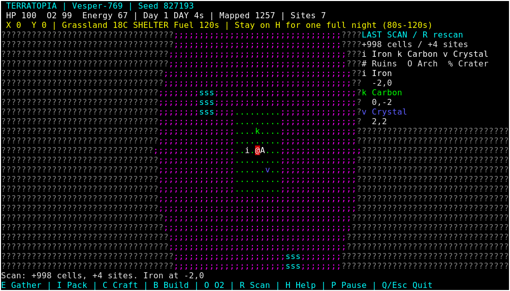

# TerraTopia — Planetary Survival

A keyboard-first, terminal-native Rust survival game using **Terrabox** for all
input and rendering. Crash beside a damaged spacecraft, scavenge emergency
supplies, mine resources, craft equipment, build a shelter and survive a night.
The Phase 1.1 procedural world, fog, scanner and bounded chunk cache remain.

No graphical frontend, secondary terminal framework, async runtime or ECS is
used. The only dependency is the existing local Terrabox crate. Rust edition 2024.

## Build and run

Keep both repositories alongside one another:

```text
parent/
  terrabox/crates/terrabox/
  terratopia/
```

```sh
cargo build --release
cargo run --release -- --seed 827193
./target/release/terratopia --seed 827193 --save expedition.save
./target/release/terratopia --save expedition.save --load
```

Without `--seed`, a clock-derived u64 seed is displayed in the HUD. Seeds accept
0 through 18446744073709551615. The default save is `terratopia.save` in the
working directory. `--save` selects a different file. The containing directory
must exist. On Windows use `target\release\terratopia.exe` in an attached console.
On Unix use a real controlling terminal with a supported TERM/terminfo entry.
Linux, Windows Terminal, macOS Terminal, SSH and Termux remain portability targets;
see the validation report for the hosts actually tested.

## First expedition

1. Enter/N opens the landing screen; Enter lands. The HUD shows your objective.
2. Press **E** beside the spacecraft `A`. The cache contains a salvage pick,
   two oxygen canisters and one battery. **H** opens a scrollable survival guide.
3. From the initial position, move **two cells west** to iron `i`. E four times
   gathers eight iron. Move two east and **two north** to carbon `k`; E three
   times gathers six carbon. Each successful action gathers two units.
4. Open **C**, select **Mining tool** and press Enter. Backspace closes the
   crafting screen. Tools work automatically while carried.
5. The crystal `v` is **two east and two south of the initial position**. Stand
   there and press E twice for four crystal. Crystal needs the crafted tool.
6. Open C, select **Shelter kit**, Enter, then Backspace. Return to the initial
   position and press **B** to build a shelter `H` underneath you.
7. Press **E** inside H to spend the cache battery and power its oxygen station
   for 120 seconds. Remain **on H** through an entire night. The first night runs
   from active second 80 to 120; dawn completes the objective. If you miss part
   of it, stay through the next full night instead.

Inventory, crafting, help and pause screens freeze time, so you can plan without
losing oxygen. Shelter protects even when unpowered; power supplies oxygen.
Oxygen canisters are emergency reserves: **O** restores up to 50 oxygen.
Completing the objective leaves the game playable. There is no spaceship travel.

All seeds receive a reachable 9x9 crash clearing and these three starter nodes,
relative to their deterministic landing position. This small expedition overlay
does not edit or invalidate generated terrain. It guarantees the first loop does
not depend on finding a lucky continent or resource arrangement.

## Controls

| Key | Action |
| --- | --- |
| Arrows / WASD | Move one cardinal tile per key event |
| E | Harvest the current deposit; scavenge beside A; power a station at A/H |
| R | Scan radius 20 and report discoveries |
| I | Inventory: Up/Down select, Enter use, X discard entire stack |
| C | Crafting: Up/Down select, Enter craft; owned/required ingredients shown |
| B | Build a carried shelter kit on clear ground underneath the player |
| O | Use an oxygen canister |
| H / ? / F1 | Help, current objective and recent event log; Up/Down scroll |
| Backspace | Close inventory/crafting/help |
| P / Space | Pause/resume; also closes a sub-screen |
| Enter while paused | Resume |
| M while paused / on landing screen | Main menu |
| Enter / N in main menu or death screen | New expedition landing screen |
| F5 | Save the current expedition |
| F9 / L | Load the selected save file, initially paused |
| Q / Escape / Ctrl+C | Save the active expedition and quit safely |
| Ctrl+Q | Quit without saving, including when a save path is unwritable |

A failed save keeps the game open and shows the error. F5 retries; Ctrl+Q exits
without a save. Loading a missing/invalid file preserves the current live game.
New expedition restarts the selected seed with fresh inventory and world changes.
A new landing overwrites the same save on the next save/normal exit, so select
separate `--save` paths to retain multiple expeditions. Death stops time; F9 can
reload an earlier living save. Quitting normally after death saves that dead state.

## Survival rules

- Oxygen falls by one every three active seconds away from a powered station.
  At zero, suffocation removes three health per second. A red warning appears at
  25 oxygen. A canister restores 50, capped at 100; full tanks preserve the item.
- Batteries power an oxygen station for 120 seconds each. Use one from inventory,
  or press E beside the ship/inside a shelter. Oxygen refills by three per second
  on or cardinally adjacent to a powered station. Stored power drains in active
  time even when you walk away; pause freezes it. Fuel caps at 600 seconds.
- Each day lasts 120 active seconds: 80 daylight, then 40 night. Night subtracts
  20C from biome temperature and doubles thermal/radiation damage frequency.
- Grassland is 18C, forest 14C, desert 44C, mountains -12C, water 5C, frozen
  terrain -30C and wasteland 24C. Mountains and water remain impassable.
- Without protection, temperatures outside 0..38C cause two damage every eight
  seconds by day/four at night. Wasteland radiation uses the same damage rule.
  Carrying a thermal suit extends tolerance to -40..65C and blocks radiation.
  Extremely cold frozen nights still require shelter.
- Standing on a shelter tile protects against all environmental hazards, holds
  the interior at 18C and slowly heals if oxygen is above 20. Adjacent ground
  receives station oxygen when powered, but not shelter protection.
- Movement costs one energy; harvesting costs two. Energy slowly regenerates,
  faster inside shelter. Zero energy currently does not prevent actions.
- The mission requires one uninterrupted complete night inside shelter, alive
  at dawn. Its progress and completion flag are saved.

## Gathering, inventory and recipes

| Resource | Glyph | Tool |
| --- | --- | --- |
| Iron | `i` | Salvage pick or mining tool |
| Carbon | `k` | Hands |
| Crystal | `v` | Crafted mining tool |
| Copper | `c` | Salvage pick or mining tool |
| Silica | `s` | Salvage pick or mining tool |

All have distinct glyphs and colours; identity never depends solely on colour.
Each deposit **cell** contains 12 units. Fully mined cells lose their marker;
partly mined cells retain their remaining amount. Changing/evicting terrain
chunks never replenishes them. Copper and silica remain discoverable and
collectible, but have no recipes in this first loop.

Inventory has ten slots. Materials, canisters and batteries stack to 20; tools,
suits and shelter kits use one slot each. Crafting and scavenging are atomic:
missing ingredients or insufficient output capacity never consume supplies.
Harvesting with a full pack does not deplete the deposit. X permanently discards
the selected stack; keep your tools unless you have a replacement.

| Crafted item | Ingredients |
| --- | --- |
| Mining tool | 3 iron, 2 carbon |
| Shelter kit | 4 iron, 4 carbon, 2 crystal |
| Oxygen canister | 2 carbon, 1 crystal |
| Battery | 1 iron, 1 crystal |
| Thermal suit | 3 carbon, 1 crystal |

Shelters occupy one walkable cell. Build away from the spacecraft and landmark
markers; a fully mined deposit is clear ground. A kit includes an initially
unpowered oxygen station. There is no base editor, tool durability or equipment
slot management in this iteration.

## Interface and exploration



[Crafting screenshot](assets/screenshots/crafting.png). These are unedited Linux
xterm captures of the release binary, not generated artwork. See the
[capture guide](assets/screenshots/README.md).

Compact explanatory layout (not a runtime capture):

```text
 TERRATOPIA | Vesper-769 | Seed 827193
 HP 100  O2 100  Energy 80 | Day 1 DAY 12s | Mapped ...
 X 0  Y 0 | Grassland 18C SHELTER | Stay on H for one full night
?????????;;;;;?????????
?????......k....???????
?????....i.@A..v???????
?????..........???????
Shelter built! Stay on H through a full night. Battery powers oxygen.
E Gather | I Pack | C Craft | B Build | O O2 | R Scan | H Help | P Pause
```

The camera follows the player independently of terminal dimensions. Unknown
cells are dark `?`, remembered terrain is grey, and current sight is coloured.
Normal sight has radius 7; R scans radius 20 until the next successful move.
The scan panel shows the three nearest currently present signals. Depleted
cells disappear from scan results; historical discovery counts are retained.
Ruins `#`, basalt arches `O` and craters `%` remain decorative landmarks.
Grass `.`, forest `T`, desert `:`, mountains `^`, water `~`, ice `*` and wasteland
`;` retain the Phase 1 terrain vocabulary. Ship `A`, shelter `H` and player `@`
are expedition overlays.

The HUD shows oxygen/health warnings, biome, temperature, day/night and objective.
H also displays the last six event messages. Below 40x12, a resize message replaces
the map. State persists across resize; long HUD/help lines clip in narrow windows.
80x24 or 100x30 is recommended. Terminal themes determine actual palette colours.

## Determinism and persistence

A u64 seed and signed i64 coordinates feed integer coherent elevation,
temperature and moisture noise. The original three weighted octaves (128/64/32)
and biome classification remain unchanged. Aligned chunk generation reuses
lattice samples without changing fixed-point rounding. Chunks are 32x32, lazy,
and cached with a 128-chunk distance-based bound. Negative coordinates use
Euclidean division; checked movement and i128 geometry handle world edges.

Landmarks belong to a separate coordinate grid. Existing iron/copper/silica,
ruins and geological placements remain; formerly empty regions now supply
carbon or crystal. Generation order, viewport size and cache contents do not
affect placement. Crash clearing, structures and harvested amounts live in
`Camp`, separately from immutable base terrain. Exploration masks/site records
are likewise independent of the terrain cache.

Saves use a strict text format headed `TERRATOPIA_SAVE 1` and `GENERATOR 2`.
They store seed, coordinates, health/oxygen/energy, active ticks, inventory,
cache/power state, shelters, partial/full harvesting, night-objective progress,
exploration masks and historical discoveries. Loaded games start paused with
normal sight; the transient last-scan panel/event history is not serialized.
No offline time elapses. Unsupported versions, malformed/truncated data and
out-of-range records are rejected before replacing the live game.

Writes use an exclusive temporary file beside the target, flush it, then rename
over the save. Failures leave the prior save intact. This is a local-file save,
not cloud synchronization or a guarantee against every filesystem/power-loss
scenario. Limits: 8 MiB, 1,000 shelters, 100,000 harvested cells, 20,000 fog chunks
and 100,000 discoveries. Oversized expeditions report save failure rather than
silently discarding data. There are no save migrations yet.

## Architecture and checks

`main.rs` owns CLI, Terrabox lifetime, event waits and save I/O. `game.rs` handles
states/actions and bounded fixed updates. `survival/` owns environmental/vital
rules; `inventory.rs` and `crafting.rs` own stacks and recipes; `planet.rs` owns
expedition overlays; `persistence.rs` owns versioned encoding/validation/files.
`world/` remains pure deterministic terrain/landmarks plus cache. `exploration.rs`
owns knowledge, and `renderer.rs`, `camera.rs`, `ui/` draw Terrabox surfaces.

Simulation uses fixed 250ms steps, at most four catch-up steps after a stall.
Input, simulation and rendering remain separate. Active survival redraws once
per second or on input/resize; menu, pause and sub-screens block without timer
wakes. Terminal RAII restores state on normal exit and unwinding; forced
termination/abort remains outside that guarantee.

```sh
cargo fmt --all --check
cargo clippy --all-targets -- -D warnings
cargo test
cargo build --release
python3 scripts/smoke-terminal.py
python3 scripts/smoke-terminal.py --full-night  # actual timed shelter-to-dawn run
python3 scripts/capture-terminal.py            # optional X11 capture tools
cargo check --target x86_64-pc-windows-gnu      # installed target, compilation only
```

See [validation](docs/validation.md), [integration review](docs/engine-review.md)
and the historical [Phase 1.1 performance report](docs/performance.md). The
benchmark example remains a CPU workload, not a survival/emulator latency claim.

Next: tune resource/hazard balance with playtesting, validate native Windows,
macOS and Termux, and expand resource use within this loop. Creatures, weather,
galaxies, spaceship travel and multiplayer are intentionally outside Phase 2.
