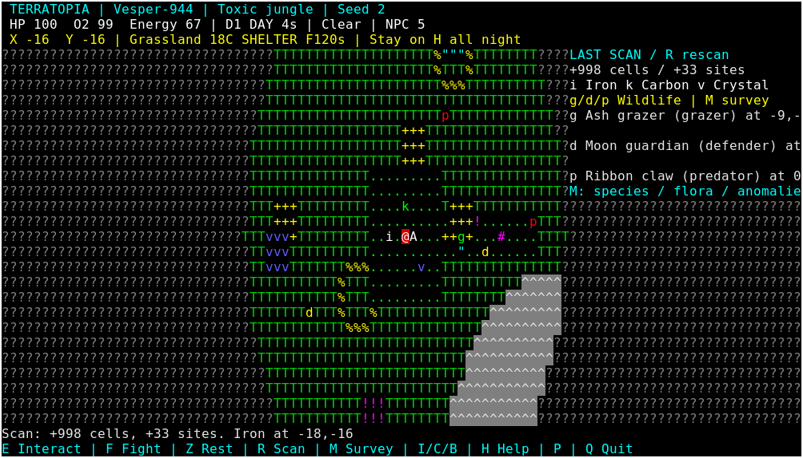

# TerraTopia — Living Alien Worlds

A terminal-native Rust exploration and survival game, using **Terrabox** for all
keyboard input and cell rendering. Crash-land, scavenge, gather, craft a shelter,
survive the night, then explore a living world with alien wildlife, changing
weather, harvestable flora and interactive ruins.

Phase 3 extends the existing modular game. Shared infrastructure now comes from
**TerraGame**: fixed steps, coordinate hashing/indexing, the chunk cache, camera
positioning and the Terrabox session adapter. There are no new third-party
dependencies, threads, ECS, async runtime or alternative rendering backend.
See [engine integration](docs/terragame-integration.md) for scope and compatibility.

## Build and start

Use stable Rust supporting edition 2024, with sibling repositories:

```text
parent/
  terrabox/crates/terrabox/
  terragame/crates/          # core, world, terminal
  terratopia/
```

```sh
cargo build --release
cargo run --release -- --seed 827193       # temperate example
cargo run --release -- --seed 2            # toxic jungle example
./target/release/terratopia --seed 2 --save jungle.save
./target/release/terratopia --save jungle.save --load
```

No seed selects a clock-derived u64 seed, displayed in the interface. The default
save is `terratopia.save` in the current directory; `--save` selects another file
whose parent directory must exist. On Windows use `target\release\terratopia.exe`
in an attached console. Unix requires a real controlling TTY and supported TERM.
Linux, Windows Terminal, macOS Terminal, SSH and Termux are portability targets;
the [validation report](docs/validation.md) distinguishes actual runtime tests
from compilation checks.

## First-session survival loop

1. Enter/N, then Enter to land. **E beside A** collects a salvage pick, two
   oxygen canisters and a battery. **H** opens a guide; menus pause time.
2. From the initial position, go **two west** to iron `i`; E four times yields
   eight iron. Go two east and **two north** to carbon `k`; E three times yields
   six carbon. Every mineral action gathers up to two units.
3. **C**, select Mining tool, Enter, Backspace. Tools work while carried.
4. Crystal `v` is **two east and two south of the initial position**. E twice
   gathers four crystal, using the crafted tool.
5. C, select Shelter kit, Enter, Backspace. Return to the initial position and
   **B** to build shelter `H` under the player. E uses the emergency battery to
   power the shelter's oxygen station for 120 active seconds.
6. Stay **on H** for an entire night: active second 80 through 120. If you miss
   part of the first night, remain through the next complete night. Dawn reports
   success; you can keep exploring afterwards.

Every new seed has a safe 9x9 crash clearing, reachable starter nodes and a
protected spacecraft field. It neutralises planetary climate/radiation/toxic
hazards and storms locally, while preserving atmospheric oxygen rules. Night
can still be mildly cold outside shelter. The starter resource capacities and
costs are fixed, so all seven planet types can complete this loop. Shelter
protection is separate from the crash field; camping in the field alone does
not complete the shelter objective.

## Explore the living world

After building, rest with **Z** to replenish energy before leaving. A short
walkable survey trail extends east of a new crash site. Relative to the initial
position: medicinal flora at `(5,0)`, glow fungus at `(7,1)`, venom vegetation at
`(9,-1)`, and an abandoned ruin at `(12,0)`. These teaching sites supplement the
natural planet-wide generation. Legacy expeditions retain their original terrain
and have natural ecology, without the added teaching trail.

Scan with **R** to discover nearby plants, minerals, ruins, wildlife and storm or
atmospheric anomalies. **M while playing** opens a paused survey: atmosphere,
climate, gravity, hazards, density/richness, forecast, visible species, scan
contacts and recovered records. The scanner shows a small local circle, never
the whole world. The map uses coloured current sight, grey remembered terrain
and dark `?` for unknown cells. Moving returns a scan to normal sight.

Four creature categories have distinct glyphs:

| Glyph | Behaviour | Response |
| --- | --- | --- |
| `g` | Passive grazer | Flees when you come within four cells |
| `d` | Defensive territorial animal | Attacks when approached within two cells or provoked |
| `p` | Predator | Hunts prey when hungry; warns/pursues nearby players |
| `s` | Scavenger | Searches for uneaten remains |
| `x` | Unlooted corpse | Stand on it and E to recover organics |

Species names, health, speed, preferred biome, sensing range and storm resistance
come from separate deterministic seed streams. Predators/defenders announce
aggression, move every few seconds and attack when cardinally adjacent. Move
away to escape. **F** attacks an adjacent creature for eight damage and costs
four energy. Creatures block movement and cannot stack, enter impassable ground,
occupy the player cell or enter shelter/the crash clearing. Shelters and the
crash field block creature attacks. Movement uses direct steps and bounded local A* around obstacles.

Creatures now forage, eat, rest, flee, defend territory and hunt other animals.
Hunger, energy, fear, age, health, habitat and weather influence their decisions.
Plants and remains can be consumed once; births need fed mature parents and
regional capacity. Every activated animal retains a persistent identity.

Individuals activate within 48 cells around the player, with a 1,024-record
stress ceiling. Dormant regions retain records and bounded population summaries;
only summaries advance each minute. Reloading terrain cannot reset kills or food.
The [ecosystem architecture](docs/ecosystem.md) explains identity, scheduling,
limits, approximate dormancy and save migration. Measured 100/1,000 active and
10,000 dormant workloads are in [Phase 4 performance](docs/performance-phase4.md).

## Planet profiles and weather

New worlds use generator **3**. Seven archetypes derive from the seed:
temperate terrestrial, frozen wasteland, desert, toxic jungle, irradiated,
volcanic and barren rocky. A profile includes atmospheric composition, oxygen,
climate base/night variation, gravity, radiation, toxicity, water, vegetation,
wildlife and mineral richness. These are functional values:

- Water, temperature and vegetation shift the original coherent climate fields
  before biome classification, creating different planetary terrain mixes.
- Richness changes natural deposit capacity; vegetation and wildlife abundance
  change suitable-site frequency. Habitat restrictions still apply.
- Climate and small local biome offsets set temperature; night subtracts the
  planet's variation, then weather modifies it. Radiation/toxicity add exposure.
- Outside the crash clearing, gravity makes movement cost one or two energy.
- Clean atmospheres with at least 18% oxygen slowly restore oxygen. Low-oxygen
  or toxic atmospheres consume it; very thin atmospheres consume it faster.

Weather is regional and deterministic from seed, biome and active ticks. Each
64-second regional period has clear weather, an eight-second forecast before
onset, then up to 24 seconds of weather that ramps and fades in severity. Mild
wooded regions have more clear periods and weaker storms; exposed or hostile
worlds have more frequent, stronger weather. Some periods stay clear. Terrain and planet archetype choose the condition:

| Weather | Gameplay |
| --- | --- |
| Clear | Normal sight 7 / scan 20 |
| Rain | Colder; sight 5 / scan 16 |
| Dust storm | Warmer; sight 4 / scan 8 |
| Snowstorm | Much colder; sight 4 / scan 10 |
| Toxic storm | Unfiltered damage and unsafe breathing; sight 5 / scan 12 |
| Radiation storm | Unprotected damage; sight 5 / scan 12 |

The HUD retains a forecast countdown, and the event log warns before onset.
Crossing into an already stormy region can expose you immediately. Return to H
or the crash field before a severe storm; weather keeps progressing while you
rest. Visibility changes update fog without erasing exploration memory. There
are no particle floods or high-frequency weather animations.

## Ecology, loot and survival equipment

| Plant | Glyph | Yield / effect |
| --- | --- | --- |
| Ribbon fern | `&` | Two organics |
| Glow fungus | `"` | Two organics; rare frozen/forest/wasteland flora |
| Venom frond | `!` | Two organics; three contact damage without an active filter |
| Medicinal starleaf | `+` | Two medicinal herbs |

Stand on a plant and E. Plants have deterministic clustered placement and biome
restrictions. Harvested cells do not regrow in this phase; depletion survives
save/load and chunk eviction. An unsuccessful full-pack harvest changes nothing.

Stand on **#** and E to salvage a ruin. Each seed/anchor deterministically yields
technology salvage, a battery or oxygen canister, and crystal. Supplies are
awarded atomically and once per ruin, including multi-cell structures. Looted
state and recovered planetary records survive saving/eviction. Salvage is useful
for survival; technology components are collectible but have no recipe yet.

Inventory remains ten slots. Materials, supplies and consumables stack to 20;
tools/suits/kits occupy a slot each. Up/Down select, Enter uses, X discards a
whole stack. Tools/suits apply while carried. Capacity or ingredient failures
never consume items, nodes, plants or loot.

| Recipe | Ingredients |
| --- | --- |
| Mining tool | 3 iron, 2 carbon |
| Shelter kit | 4 iron, 4 carbon, 2 crystal |
| Oxygen canister | 2 carbon, 1 crystal |
| Battery | 1 iron, 1 crystal |
| Thermal suit | 3 carbon, 1 crystal |
| Medical kit | 2 herbs, 1 carbon; heals 35 |
| Hazard filter | 2 organics, 1 crystal; 120 active seconds of toxic protection |
| Energy pack | 2 organics, 1 carbon; restores 40 energy |

Iron/copper/silica need a pick or mining tool; crystal needs the crafted tool;
carbon can be gathered by hand. Starter cells contain 12 units. Natural capacity
scales with mineral richness (bounded 6..24). Glyphs `i/k/v/c/s` identify iron,
carbon, crystal, copper and silica without relying on colour. Copper/silica and
technology have no additional recipes in this iteration.

Health, oxygen and energy all matter. Movement spends energy, mineral/plant
harvesting costs two/three, ruin salvage two, and combat four. Insufficient energy
blocks the action and begins resting; ordinary waiting also recovers slowly, so
zero energy cannot permanently lock movement. Z toggles faster resting: five
energy/second, or eight in shelter. Rest does **not** stop wildlife or weather.

Oxygen drains by one every three active seconds in non-breathable air, or every
two in very thin air; breathable conditions restore one every six seconds. O
uses a canister (+50). At zero oxygen, suffocation costs three health/second.
A powered A/H station restores three oxygen/second on its cell or cardinally
adjacent. Batteries add 120 seconds of fuel, capped at 600. Shelter protects only
when standing **on H**, even though station oxygen reaches adjacent cells.

Thermal suits extend temperature tolerance from 0..38C to -40..65C and protect
against radiation. Filters protect against atmospheric toxicity, toxic storms
and venom plants. Extreme cold can still require shelter. Environmental damage
is evaluated every eight seconds by day/four at night; multiple exposures combine
in one testable calculation. Shelter holds 18C, blocks exposure/creature damage
and heals slowly if oxygen is sufficient. Full health/energy/oxygen preserve
consumables; unused filters can be stacked for up to 240 seconds of protection.

## Keyboard and interface

| Key | Action |
| --- | --- |
| WASD / arrows | One cardinal movement per key event |
| E | Interact, gather, salvage, scavenge or power a station |
| F | Attack adjacent wildlife |
| Z | Toggle resting while the simulation continues |
| R | Local scan, including wildlife/flora/anomalies |
| M while playing | Paused planet/exploration survey |
| I / C | Inventory / crafting (time paused) |
| B / O | Build carried shelter kit / use oxygen canister |
| H / ? / F1 | Help, current objective and recent events |
| Backspace | Close a modal; Up/Down scroll/select; Enter confirm |
| P / Space | Pause/resume (or close a modal) |
| Enter while paused | Resume |
| M while paused | Main menu, retaining the original control |
| F5 / F9 or L | Save / load (loaded games start paused) |
| Q / Escape / Ctrl+C | Save and quit |
| Ctrl+Q | Exit without saving, including after an unwritable-path error |

80x24 is the primary target. Three HUD rows show planet, biome, weather/countdown,
temperature, vitals, nearby creature count and compact objective. M provides the
longer data without crowding the map. Below 40x12 a resize message replaces the
view; state is retained. Long coordinates/lines may clip in narrow terminals.



[Planet survey](assets/screenshots/planet-survey.png) ·
[Actual toxic storm](assets/screenshots/storm.png) ·
[Crafting](assets/screenshots/living-crafting.png)

These are real xterm captures, not mockups or generated art. See the
[capture guide](assets/screenshots/README.md). Terrain retains `. T : ^ ~ * ;`,
landmarks `# O %`, ship A, shelter H and player @. Only currently visible wildlife
is drawn; remembered map cells never display stale creature positions.

## Saves and compatibility

Current files use **TERRATOPIA_SAVE 3** and explicitly store generator **2 or 3**.
Schema 1 / generator 2 files are imported with their **exact original terrain**,
seed, coordinates, inventory, shelters, resources, fog and night progress. Legacy
worlds use neutral legacy planetary parameters; their new ecology/weather layer
is additive. They do not silently switch to generator 3 terrain.

Schemas 1 and 2 import with their existing creature IDs and explicit default
needs; saved actors become retained residents. On first overwrite, an exact
`.v1.bak` or `.v2.bak` copy is created,
including original line endings. A conflicting different backup causes a clear
save error rather than replacement. The upgraded file retains generator 2. New
expeditions use generator 3; there are no migrations from unknown future schemas
or unsupported generators. A genuine pre-change fixture tests this strategy.

New saves include plants, ruin loot, filters, resting, active wildlife, relevant
persistent creature state and scanned identities. Weather reconstructs exactly
from saved time/position/seed; no offline time passes. Transient scan panels and
event text are rebuilt. The full replacement is parsed/validated before the
live game changes, and loaded games start paused. Q normally auto-saves; a failed
save keeps the game open so F5 can retry or Ctrl+Q can exit without writing.

Writes use an exclusive same-directory temporary file, flush and rename; failed
writes preserve the prior save. Limits: 8 MiB; 1,000 shelters; 100,000 harvested
mineral/plant cells, fog discoveries or scanned creatures; 20,000 fog chunks;
10,000 looted ruins, persistent creature records and region summaries;
1,024 active creature records. Population/needs/time records use schema 3.
Unsupported/malformed/oversized data is rejected. There is no cloud sync or
universal filesystem/power-loss guarantee. Use separate `--save` paths for
multiple expeditions; a fresh landing uses the selected file on the next save.
Normal exit after death saves the dead state; F9 can load an earlier living save.

## Architecture, validation and scope

Immutable generation lives in `world/` (profile, climate noise, terrain,
landmarks, flora) with a bounded 128-chunk cache. `planet.rs` owns expedition
modifications and loot; `wildlife.rs` owns bounded active AI and relevant entity
memory; `weather.rs` derives regional forecasts; `survival/` combines exposure
and vitals. Existing inventory/crafting, exploration, camera, Game state machine
and Terrabox Surface/Canvas rendering remain. `persistence.rs` owns schemas and
validation; `main.rs` owns terminal lifetime, blocking waits and save I/O.

The fixed timestep is 250ms, with at most four catch-up steps after a stall.
Species movement/weather choices use separate salted hashes of IDs/coordinates
and ticks, not a global random stream. AI updates once per active second, moves
at species cadence and resolves occupancy in ID order. Weather has no unbounded
cache. Menus, help, inventory, crafting, survey, pause and death have no simulation
deadlines. Playing redraws once per second or on input/resize, with Terrabox's
changed-row output. RAII restores normal terminal state on return/unwinding;
forced termination/abort remains outside that guarantee.

```sh
cargo fmt --all --check
cargo clippy --all-targets -- -D warnings
cargo test
cargo build --release
python3 scripts/smoke-terminal.py
python3 scripts/smoke-terminal.py --full-night
cargo run --release --example benchmark
python3 scripts/capture-terminal.py  # optional X11/xterm/ImageMagick tooling
cargo check --target x86_64-pc-windows-gnu  # compilation only
```

See [validation](docs/validation.md), [integration review](docs/engine-review.md)
and [Phase 3 performance](docs/performance-phase3.md). The full-night PTY scenario
uses a real timed toxic-world expedition, including flora/ruins/hostile escape,
storm warning/onset, shelter, dawn, saving, loading and continued exploration.

Limits: simple local AI can become blocked, ambient uninjured animals may respawn,
plants/minerals do not regrow, shelters remain single-cell, and exploration memory
grows up to documented save limits. There are no quests beyond shelter survival,
weather particles, food/thirst simulation, massive recipe catalogue, spaceship
travel, galaxies or multiplayer. Next: balance/playtest this loop, improve local
AI/navigation where needed, and validate native Windows/macOS/Termux before
expanding the planetary simulation.

## Phase 4 living ecosystem

See [architecture](docs/ecosystem.md), [measured performance](docs/performance-phase4.md)
and [validation and limitations](docs/validation-phase4.md). Run the release workloads:

```sh
cargo run --release --example ecosystem_benchmark
```

[Actual ecosystem gameplay](assets/screenshots/ecosystem.png) ·
[Creature inspection](assets/screenshots/ecosystem-inspection.png).
Capture these with `python3 scripts/capture-ecosystem.py` on X11/Xwayland.
